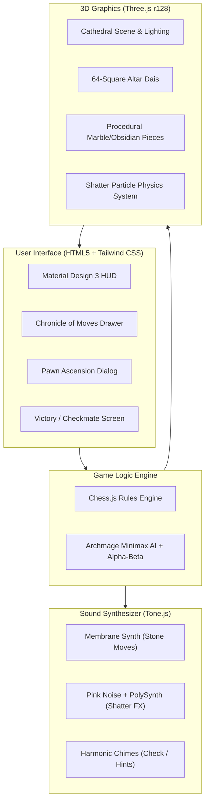

# ♟️ Wizard's Chess 3D — Minimalist Gothic Cathedral

<div align="center">


<p align="center">
  <b>A cinematic 3D Wizard's Chess simulation set in a minimalist Gothic cathedral sanctuary.</b><br>
  Featuring real-time 3D piece-shattering particle physics, procedural stone acoustics, an Archmage Minimax AI opponent, and Material Design 3 glassmorphic HUD.
</p>

[🎮 **Play Live Demo**](https://fawadullah15.github.io/wizards-chess-3d/) • [✨ Features](#-key-features) • [🕹️ Controls](#-controls--camera) • [📐 Architecture](#-system-architecture) • [🚀 Quick Start](#-quick-start)

---

</div>

## 📖 Overview

**Wizard's Chess 3D** brings the mystical, high-stakes duels of enchanted chess to life right in your web browser. Built entirely with **Three.js**, **Tone.js**, and **Chess.js**, this experience requires **zero build tools, zero external assets, and zero package installations**. Every 3D sculpture, procedural marble texture, and Gothic cathedral architectural element is rendered in real-time WebGL, accompanied by fully synthesized Web Audio acoustics.

When a piece takes another in Wizard's Chess, it doesn't simply slide into place: it executes an aggressive leaping strike, violently shattering the captured opponent into dozens of physical 3D dodecahedral fragments that bounce, spin, and disintegrate across the stone altar.

---

## ✨ Key Features

### 🏛️ Minimalist Gothic Cathedral Environment
- **Gothic Nave & Ribbed Vaulting**: Clustered stone pillars supporting pointed ribbed vault arches spanning across the hall.
- **Architectural Atmosphere**: Lancet stained glass windows cast a moody moonlit cyan radiance, flanked by a grand 12-radial rose window in the apse.
- **Dynamic Lighting & Volumetric Fog**: Four corner altar candle braziers and flickering wall torch sconces cast soft real-time shadows (`PCFSoftShadowMap`) through an atmospheric fog veil (`THREE.FogExp2`).

### ♟️ Procedurally Sculpted Marble & Obsidian Armies
- **Custom Procedural Textures**: Generative organic vein patterns on polished White Marble and deep volcanic Black Obsidian with sacred gold and twilight trims.
- **Unique Piece Geometries**:
  - **King**: Sovereign monarch crowned with a cathedral cross finial.
  - **Queen**: High sorceress with 6-pointed coronet spires and a hovering arcane pearl.
  - **Bishop**: High prelate with ceremonial mitre and floating halo.
  - **Knight**: Armored Destrier warhorse with flowing mane and angled neck.
  - **Rook**: Cathedral bastion tower flanked with crenellations and stone parapets.
  - **Pawn**: Gothic acolyte bearing a glowing arcane orb.
- **Living Pieces**: Idle breathing and swaying animations give the pieces an uncanny, enchanted presence. Selected pieces levitate into the air with arcane energy.

### 💥 Wizard's Chess Combat & Particle Physics
- **Kinetic Leaping Strikes**: Attacking pieces wind up, charge forward, and execute a heavy downward crushing strike.
- **3D Shatter Particle Engine**: Captured pieces explode into 30+ physical 3D shards governed by real-time velocity, gravity, chessboard floor collisions, and smooth decay.
- **Arcane Shockwaves**: Concentric glowing energy rings expand along the altar stone upon impact.

### 🧠 Archmage Minimax AI Opponent
- **Integrated AI Engine**: Minimax decision tree with alpha-beta pruning and dynamic positional piece-square evaluation.
- **Aggressive Combat Bias**: The Archmage is tuned with a high-capture priority heuristic for thrilling, cinematic battles.
- **Game Modes**: Switch seamlessly between **vs. Archmage AI** and **2-Player Local Pass & Play**.

### 🎵 Cathedral Acoustics (Tone.js Synthesized Audio)
- **100% Procedural Web Audio**: Zero external audio files required!
- **Deep Membrane Thuds**: Heavy resonant sub-bass when stone bases slide across the dais.
- **Crystalline Shanders**: Pink noise bursts layered with polyphonic high-chime chords mimic shattering stone and crystal.
- **Sacred Harmonics**: Tonal chimes for piece selection and ominous minor chords upon Check.

### 🔮 Material Design 3 Glassmorphism HUD
- **Real-Time Turn Indicator**: Glowing pulsating aura signaling current initiative and check status.
- **Captured Relics Tray**: Displays shattered obsidian and marble trophies with classical unicode iconography.
- **Chronicle of Moves**: Collapsible move history drawer recording standard algebraic notation with capture badges (`✦`).
- **Tactical Arcane Hint**: Computes the optimal strategic move and highlights it with radiant runes.
- **Ascension of the Pawn**: Modal dialog allowing pawn transfiguration into Queen, Rook, Bishop, or Knight.
- **Undo Engine**: Seamlessly rewind moves (single turn in 2P, paired round-trip in vs AI).

---

## 🕹️ Controls & Camera

### 🖱️ Mouse & Touch Navigation
| Input | Action |
| :--- | :--- |
| **Left Click / Tap** | Select a piece or choose a destination tile |
| **Left Drag** | Orbit camera around the Cathedral altar |
| **Mouse Wheel / Pinch** | Smoothly zoom in and out (13–42 units) |

### 🎥 Cinematic Camera Presets
Cycle through 4 handcrafted cathedral perspectives using the **Cam** button:
1. **White Sanctuary**: Traditional baseline perspective behind White's ranks.
2. **Black Belfry**: Elevated opposite perspective behind Black's forces.
3. **Nave Isometric**: High-angle Gothic isometric view overlooking the full sanctuary.
4. **Rose Overhead**: Orthographic bird's-eye view looking directly down from the rose window ceiling.

---

## 📐 System Architecture



---

## 🚀 Quick Start

Because this project is built with vanilla modern JavaScript and CDN-hosted libraries, **no installations or build steps are required**.

### Option 1: Direct Browser Launch
Simply double-click `index.html` or `wizard_s_chess_3d_gothic_cathedral.html` to run the game in any modern WebGL2-compatible browser (Chrome, Edge, Firefox, Safari).

### Option 2: Run via Local HTTP Server
If you prefer running through a local development server:

```bash
# Using Node.js (npx)
npx serve .

# Or using Python 3
python -m http.server 8000

# Or using PHP
php -S localhost:8000
```
Then navigate to `http://localhost:8000` in your browser.

---

## 📂 Project Structure

```
chess/
├── index.html                              # Primary web entry point (GitHub Pages compatible)
├── wizard_s_chess_3d_gothic_cathedral.html # Standalone cathedral game file
├── README.md                               # Comprehensive documentation & guide
└── LICENSE                                 # MIT Open-Source License
```

---

## 🛠️ Built With

* **[Three.js (r128)](https://threejs.org/)** — WebGL 3D rendering engine, shadow maps, and particle effects.
* **[Chess.js (v0.10.3)](https://github.com/jhlywa/chess.js)** — Comprehensive chess logic, move validation, check/draw validation, and FEN/PGN history.
* **[Tone.js](https://tonejs.github.io/)** — Web Audio framework synthesizing dynamic stone and impact sounds.
* **[Tailwind CSS](https://tailwindcss.com/)** — Modern glassmorphism UI styling.
* **[Google Fonts](https://fonts.google.com/)** — *Cinzel* Gothic serif and *Inter* typography.

---

## 📜 Rules of the Cathedral Duel

1. **Standard Chess Rules**: All official FIDE rules apply, including castling, en passant, pawn promotion, and draw detection (stalemate, threefold repetition, 50-move rule).
2. **Pawn Ascension**: Advancing a pawn to the eighth rank triggers the sacred promotion altar, allowing you to transfigure your pawn into a Queen, Rook, Bishop, or Knight.
3. **Capture by Destruction**: Capturing an opposing piece shatters it into stone remnants.
4. **Arcane Hints**: If you find yourself in a tight position, summon an arcane hint to reveal the Archmage's tactical recommendation.

---

## 🤝 Contributing

Contributions, issues, and feature requests are welcome!
Feel free to check out the [issues page](https://github.com/Fawadullah15/wizards-chess-3d/issues).

1. Fork the Project
2. Create your Feature Branch (`git checkout -b feature/GothicRelic`)
3. Commit your Changes (`git commit -m 'Add new Gothic relic'`)
4. Push to the Branch (`git push origin feature/GothicRelic`)
5. Open a Pull Request

---

## 📄 License

Distributed under the **MIT License**. See [`LICENSE`](LICENSE) for more information.

---

<div align="center">
  Crafted with ⚔️ and ✨ by <a href="https://github.com/Fawadullah15"><b>Fawadullah Imraj</b></a>
</div>
